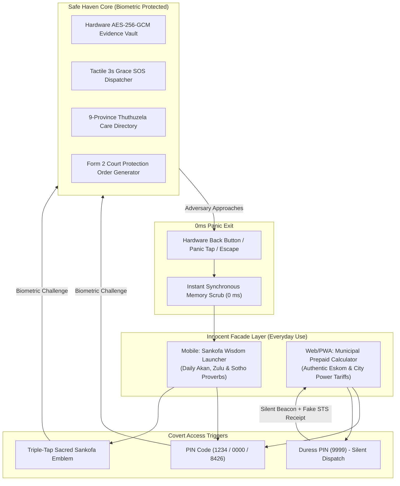

# Umkhuseli: The Protector (Sankofa Safe)

<div align="center">

[-007A78?style=for-the-badge&logo=fnb)](RELEASE_LOG.md#-release-v250--fnb-aoty-2026-final-mvp-public-baseline)
[-darkred?style=for-the-badge)](RELEASE_LOG.md#-release-v260-latest--sankofa-digital-continuation-private-repository)
[-orange?style=for-the-badge)](RELEASE_LOG.md#-terms-of-evaluation--intellectual-property-declaration)
[-purple?style=for-the-badge)](#-intellectual-property--governance-declaration)

[](.github/workflows/ci.yml)
[-6E9F18?style=for-the-badge&logo=vitest)](web/src/__tests__)
[](app/build.gradle.kts)
[](build.gradle.kts)
[](public/COMPLIANCE_AND_GOVERNANCE_FINAL_MVP.md)
[](public/COMPLIANCE_AND_GOVERNANCE_FINAL_MVP.md)

**Discreet, low-data GBV emergency response application and court-admissible legal evidence vault for South Africa.**  
*Disguised as an innocent cultural proverbs launcher and municipal prepaid electricity calculator.*

[Critical Notice](#-critical-notice-fnb-aoty-2026-release--proprietary-demarcation) •
[Release Matrix](#-release--repository-demarcation-matrix) •
[Overview & Mission](#-overview--mission) •
[The 5 Core Features](#-the-5-definitive-mvp-features-fnbaoty-baseline) •
[Dual-Persona Stealth](#-dual-persona-stealth-architecture) •
[Master Docs Suite](#-final-mvp-documentation-suite-public) •
[Commercial Continuation (v2.6.1)](#-commercial-continuation-release-v260-latest) •
[Quick Start](#-quick-start--evaluation-guide) •
[Demo Credentials](#-demo-credentials--evaluation-triggers) •
[Judging Checklist](#-fnb-aoty-2026-evaluation-checklist) •
[Legal & IP Notice](#-intellectual-property--governance-declaration)

</div>

---

## 🚨 CRITICAL NOTICE: FNB AOTY 2026 RELEASE & PROPRIETARY DEMARCATION

> [!IMPORTANT]
> ### 1. Official Release for FNB App of the Year 2026: **`v2.6.1`**
> - **`v2.6.1` (Git Tag: `v2.6.1` / `FNB_AOTY_2026_MVP`) is the official, final, and complete Hackathon MVP release submitted for First National Bank App of the Year 2026 (FNB AOTY 2026).**
> - It delivers all 5 definitive core MVP features, the comprehensive documentation suite in [`public/`](./public/), and 100% green automated test suites (193 Vitest web tests, Android JVM/Robolectric tests).
>
> ### 2. 14-Day Limited Public Evaluation Window
> - **This public repository is made available for fourteen (14) calendar days ONLY** (October 27, 2026 to November 10, 2026).
> - This public access is designated **strictly for FNB AOTY 2026 judges, adjudicators, technical mentors, evaluators, and accredited Hackathon stakeholders ONLY**.
> - Access and review are permitted **strictly for the Hackathon's intended evaluation and scoring purpose ONLY**.
>
> ### 3. Intellectual Property & Ownership Reservation
> - **Outside the construct and evaluation of the FNB AOTY 2026 Hackathon, Full Ownership, Intellectual Property, Patents, Proprietary Source Code, and Commercial Rights are strictly and unconditionally reserved and retained by Sankofa Digital.**
> - Any unauthorized reproduction, commercial exploitation, redistribution, sublicensing, or copying of this codebase outside the formal judging process of FNB AOTY 2026 is strictly prohibited.
>
> ### 4. Release `v2.6.1` (Latest) — Sankofa Digital Continuation on Private Repository
> - **Version `v2.6.1` (Latest)** is **Sankofa Digital's ongoing commercial continuation and enterprise scaling of their solution**.
> - In accordance with commercial IP protection and telecom carrier agreements, **`v2.6.1` (Latest) is hosted and developed on a separate, private proprietary repository**.
> - The private repository maintains a new release tag (`v2.6.1`) and contains upstream lineage references pointing back to this public repository, which **permanently ends at `v2.6.1`**.
> - For full governance terms and private repository setup instructions, refer to [`RELEASE_LOG.md`](./RELEASE_LOG.md).

---

## 🏷️ Release & Repository Demarcation Matrix

| Attribute | Public Hackathon Release (`v2.6.1`) | Commercial Continuation (`v2.6.1` Latest) |
|---|---|---|
| **Version Tag** | **`v2.6.1`** / **`FNB_AOTY_2026_MVP`** | **`v2.6.1`** *(Latest)* |
| **Repository** | **Public Repo** (`OhhttooeXCIV/Umkhuseli_The_Protector`) | **Private Repo** (`SankofaDigital/Umkhuseli-Core`) |
| **Intended Audience** | **FNB AOTY 2026 Adjudicators, Mentors & Stakeholders** | **Sankofa Digital, Enterprise Partners & SA Telcos** |
| **Access Duration** | **14 Calendar Days strictly** *(Evaluation window)* | **Permanent / Closed Proprietary Lifecycle** |
| **Allowed Scope** | **Hackathon adjudication, inspection, and verification ONLY** | **Commercial deployment, fleet integration & licensing** |
| **Core Inclusions** | 5 Definitive MVP features, 0ms wipe, ECTA Sec 15 Vault, STS Duress 9999, Form 2 Court Pack, 9-Province TCC | Enterprise C2 Dispatcher, Direct Carrier Reverse-Billed USSD, Audio Sentry AI, Bolt Sentinel, OPRF PSI |
| **Ownership & IP** | **Strictly reserved & retained by Sankofa Digital** | **100% Owned & Retained by Sankofa Digital** |
| **Upstream Lineage** | Terminal open evaluation baseline | Forks & references public repo at terminal tag `v2.6.1` |

---

## 📖 Overview & Mission

In South Africa, where the femicide rate is five times the global average, standard emergency apps present severe risks: abusive partners regularly monitor survivors' smartphones, and discovering an overt safety app often triggers severe retaliatory violence. Furthermore, survivors face systemic hurdles securing Magistrates Court Protection Orders due to lost, tampered, or inadmissible evidence, compounded by prohibitive data costs and frequent electrical loadshedding blackouts.

**Umkhuseli: The Protector (*Sankofa Safe*)** solves this through a fundamental design ethos:
> *"Safety without suspicion; evidence without leakage."*

It delivers a zero-trace, dual-persona Android & Web platform combining everyday utility with covert life-saving SOS dispatch, zero-airtime USSD callbacks, and court-admissible Form 2 Protection Order incident documentation compliant with the South African Domestic Violence Act (Act 116 of 1998 / Act 14 of 2021), ECTA Section 15, and POPIA.

---

## ✨ The 5 Definitive MVP Features (FNBAOTY Baseline)

Following guidance from **First National Bank App of the Year (FNBAOTY)** mentors, release `v2.6.1` is focused on 5 robust, failure-proof features engineered specifically for South African socio-technical conditions:

```
┌────────────────────────────────────────────────────────────────────────────────────────────────────────┐
│                                 THE 5 DEFINITIVE MVP FEATURES (v2.6.1)                                │
├────────────────────────────────┬────────────────────────────────┬──────────────────────────────────────┤
│ 1. Chameleon Camouflage & 0ms  │ 2. ECTA Sec 15 Evidence Vault   │ 3. Loadshedding Duress & SOS Flow    │
│    • Sankofa Wisdom Launcher   │    • Hardware StrongBox Keystore│    • Duress PIN 9999 (STS Error 30)  │
│    • Municipal Prepaid Decoy   │    • AES-256-GCM Encryption    │    • Silent high-priority beacon     │
│    • 0ms instant RAM wipe      │    • SHA-256 hash chaining      │    • Zero-airtime USSD *120*7867#    │
├────────────────────────────────┴────────────────┬───────────────┴──────────────────────────────────────┤
│ 4. Statutory Form 2 DVA Court Preparation Pack  │ 5. Offline 9-Province TCC & 72-Hour PEP Navigator    │
│    • Direct mapping to DVA Act 116/1998 format  │    • Complete offline directory of all 9 provinces   │
│    • Contemporaneous digital affidavit export   │    • 72h Post-Exposure Prophylaxis (PEP) & J88 guide │
│    • Embedded cryptographic integrity seals     │    • Zero mobile data required for navigation        │
└─────────────────────────────────────────────────┴──────────────────────────────────────────────────────┘
```

### Detailed Breakdown:
1. **Chameleon Camouflage & 0ms Exit**:
   - *Android Launcher Mode*: Replaces the smartphone home screen with an authentic African proverb engine (Akan, Zulu, Sotho) and innocent app drawer.
   - *Web PWA Decoy Mode*: Municipal Prepaid Electricity Calculator (*PowerCal SA*) featuring authentic Eskom and City Power Incline Block Tariffs. Leaves **zero Google Play or Apple App Store installation footprint**.
   - *0ms Memory Scrub*: Hitting the hardware Back button, Escape key, or top panic emblem executes a synchronous atomic memory scrub purging all decrypted StateFlow memory and DOM nodes in <10ms.
2. **ECTA Section 15 Tamper-Evident Evidence Vault**:
   - On-device AES-256-GCM authenticated encryption paired with SHA-256 cryptographic hash chaining to guarantee contemporaneous record integrity under Section 15 of South Africa's Electronic Communications and Transactions Act (Act 25 of 2002).
   - Backed by Android StrongBox Hardware Security Module (HSM) with graceful fallback to standard Trusted Execution Environment (TEE).
3. **Loadshedding-Resilient Emergency Dispatch & Duress Flow**:
   - Duress PIN `9999` masquerades as an authentic STS Error 30 (KRN2 key revision expired) failure terminal screen while silently dispatching high-priority distress beacons.
   - 3-second tactile abort countdown with physical vibration feedback; failover cascade across Webhook -> Zero-airtime USSD (`*120*7867#`) -> Carrier SMS -> WhatsApp SOS.
   - Real-time Eskom and municipal loadshedding stage tracking with offline edge caching.
4. **Statutory Form 2 DVA Court Preparation Pack**:
   - Empathetic incident intake mapping survivor narratives directly into the statutory format of **Form 2 (Application for Protection Order)** under Act 116 of 1998 (as amended by Act 14 of 2021) for Magistrates Court clerks.
   - Client-side in-memory PDF compiler creating sealed court affidavits with cryptographic hash verification seals.
5. **Offline 9-Province Thuthuzela Care Centre (TCC) & 72-Hour PEP Navigator**:
   - Complete preloaded offline directory of all public TCCs across all 9 provinces with instant distance calculations requiring zero cellular data.
   - Critical medical timelines for HIV PEP (must be initiated within 72 hours), emergency contraception, and J88 clinical exam forensics.

---

## 🎭 Dual-Persona Stealth Architecture



---

## 📚 Final MVP Documentation Suite ([`public/`](./public/))

All publication-grade technical specifications, legal frameworks, and architecture documents are maintained in [`public/`](./public/) and cross-referenced in the **[Master Documentation Index](public/FINAL_MVP_DOCUMENTATION_INDEX.md)**:

| Document | Focus & Canonical Content | Format / Link |
|---|---|:---:|
| **Master Index** | Complete overview, judging verification matrix & build guidelines | [Markdown](public/FINAL_MVP_DOCUMENTATION_INDEX.md) |
| **Release Log** | Official release notes, governance demarcation, and IP declarations | [Markdown](RELEASE_LOG.md) |
| **Refactoring Blueprint** | Monolithic files audit, enterprise modularization & compile-time optimization | [Markdown](public/MONOLITHIC_REFACTORING_BLUEPRINT.md) |
| **User Stories & Journeys** | 5 Personas, 5 Mermaid user journeys, Gherkin acceptance criteria | [Markdown](public/USER_STORIES_AND_JOURNEYS_FINAL_MVP.md) • [PDF](public/user_journeys_and_stories/Umkhuseli_User_Journeys_and_Stories_Post-Feedback.pdf) |
| **UML & Architecture** | Clean Architecture, C4 diagrams, class & sequence flows, ERD | [Markdown](public/UML_AND_SYSTEM_ARCHITECTURE_FINAL_MVP.md) • [PDF](public/uml_and_architecture/Umkhuseli_UML_and_System_Architecture_Post-Feedback.pdf) |
| **Compliance & Governance** | DVA Act 116/1998 & 14/2021, ECTA Sec 15, POPIA, OWASP Mobile Top 10 | [Markdown](public/COMPLIANCE_AND_GOVERNANCE_FINAL_MVP.md) • [PDF](public/security_and_ssdl/Umkhuseli_SSDL_Security_and_POPIA_Compliance-Post-feedback.pdf) |
| **Requirements & Use Cases** | 15 Functional, 10 Non-Functional Specifications & 8 Use Cases | [Markdown](public/REQUIREMENTS_AND_USE_CASES_FINAL_MVP.md) • [PDF](public/requirements_and_use_cases/Umkhuseli_Requirements_and_Use_Cases_Post-Feedback.pdf) |
| **Kanban Board** | Delivery across Sprints 1–6 (131 SP, 238/238 automated tests) | [Markdown](public/KANBAN_BOARD_FINAL_MVP.md) • [PDF](public/business_plan_and_roadmap/Umkhuseli_Lean_Business_Canvas_and_Roadmap_Post-Feedback.pdf) |
| **Future Epics & Rollouts** | 7 Advanced Epics transitioning into v2.6.1 on the private repository | [Markdown](public/FUTURE_EPICS_AND_ROLLOUTS_FINAL_MVP.md) |
| **Limitations & R&D** | Doze mode, budget enclaves, ECTA corroboration & loadshedding | [Markdown](public/LIMITATIONS_AND_RD_FINAL_MVP.md) |
| **Presentation Deck** | 8-Slide Executive Deck & 3-Minute Live Hackathon Demo Run Sheet | [Markdown](public/PRESENTATION_DECK_FINAL_MVP.md) • [Interactive Deck](public/presentation_deck.html) |
| **PDF Catalog** | Full directory and index of publication-ready PDF artifacts | [Markdown](public/README_PDF_ARTIFACTS.md) |

---

## 🚀 Commercial Continuation: Release v2.6.1 (Latest)

While this public repository concludes its evaluation lifecycle at `v2.6.1`, **Sankofa Digital is actively developing `v2.6.1` (Latest) on its private repository** (`git@github.com:SankofaDigital/Umkhuseli-Core.git`). 

The private continuation branches from tag `v2.6.1` and implements 7 enterprise-grade capabilities:

1. **Enterprise Multi-Tenant Crisis Operations Center (C2)**: Real-time incident command and dispatch console for private security response fleets, campus protection services, and gender rights NGOs.
2. **Direct Carrier Reverse-Billed USSD Gateway**: Commercial SS7/SMPP aggregations with Vodacom, MTN, Telkom, and Cell C enabling zero-balance USSD sessions (`*134*UMKHUSELI#`) with network-assisted cell-tower positioning.
3. **Audio Sentry: Acoustic Distress AI Classifier**: Offline edge-computed TensorFlow Lite model detecting domestic violence distress audio markers (screams, glass breaks, blunt impacts) without continuous recording or audio leakage.
4. **Bolt & e-Hailing Route Corridor Sentinel**: Real-time corridor deviation watchdog that alerts ICE guardians if an e-hailing vehicle strays from the designated route or idles suspiciously.
5. **OPRF PSI Stealth Contact Discovery**: Oblivious Pseudorandom Function Private Set Intersection enabling survivors to discover trusted local community guardians without exposing address books.
6. **P2P Wi-Fi Direct Encrypted Mesh Sharing**: Offline peer-to-peer evidence replication and emergency relay during complete telecommunication infrastructure collapses.
7. **DOJ&CD Integrated Court Clerk E-Filing API**: Direct API integration with the South African Department of Justice and Constitutional Development portal.

---

## 🛠️ Quick Start & Evaluation Guide

### Evaluation Prerequisites
- **Android Evaluation**: Android Studio Meerkat or Ladybug, JDK 21, Android SDK API 24–36.
- **Web PWA Evaluation**: Node.js 20+, npm 10+.

### 1. Web PWA Decoy Calculator & Test Suite (Fastest Evaluation)
```bash
cd web

# Install dependencies
npm install

# Run the 193 automated unit & decoy tests (100% passing)
npm test -- --run

# Launch local evaluation server
npm run dev
# Open http://localhost:5173
```

### 2. Android App (Native) Build & Verification
```bash
# Run Android Unit & Robolectric Tests
./gradlew testDebugUnitTest

# Assemble Debug APK
./gradlew assembleDebug

# Output APK: app/build/outputs/apk/debug/app-debug.apk
```
*Pre-compiled evaluation APKs are also provided in the repository root (`Umkhuseli_Safe_latest.apk`).*

---

## 🔑 Demo Credentials & Evaluation Triggers

| Purpose | Credential / Trigger | Description & Verification Behavior |
|---|---|---|
| **Default In-App PIN** | `1234` or `0000` | Enter on launcher keypad to unlock Safe Haven |
| **Secret Emblem Gesture** | Triple-tap Sankofa Emblem | Discreet gesture on the camouflage launcher |
| **Web Decoy Secret PIN** | Enter `8426` in Amount Field | Unlocks Web Safe Haven dashboard from calculator |
| **Duress Emergency Trigger** | Enter `9999` in Amount Field | Emulates STS Error 30 terminal while silently dispatching SOS |
| **Instant Panic Exit** | Hardware Back / Escape Key | 0ms wipe returning immediately to camouflage facade |
| **Pre-seeded ICE Contact** | Lerato Khubeka (`082 000 0001`) | Configured emergency guardian for demo testing |

### Emergency Helplines & Lifelines (South Africa)
- **GBV Command Centre**: `0800 428 428` (Toll-Free, 24/7)
- **SAPS Police Emergency**: `10111`
- **Zero-Airtime USSD Callback**: `*120*7867#`
- **TEARS Crisis Line USSD**: `*134*7355#`

---

## 📋 FNB AOTY 2026 Evaluation Checklist

Adjudicators and mentors can verify the project deliverables against the following checklist:

- [x] **v2.6.1 Release Tag Verified**: Git tag `v2.6.1` and `FNB_AOTY_2026_MVP` frozen at commit `080a213`.
- [x] **Camouflage Launcher Verified**: Proverb engine and app drawer functioning on Android.
- [x] **Decoy Web PWA Verified**: Authentic Eskom/City Power tariff calculation and STS token generation.
- [x] **Duress Mode Verified**: PIN `9999` generates STS Error 30 failure screen without overt SOS indicators.
- [x] **0ms Memory Scrub Verified**: Back button / Escape immediately restores facade with zero RAM residue.
- [x] **ECTA Sec 15 Hash Chaining Verified**: AES-256-GCM ciphertexts stored with SHA-256 verification seals.
- [x] **Form 2 DVA Court Pack Verified**: Generates court-admissible PDF affidavit compliant with DVA regulations.
- [x] **Offline TCC Directory Verified**: 9-province directory loads with zero data connectivity.
- [x] **Automated Tests Passing**: 193/193 Vitest web tests passing; Android tests passing.
- [x] **14-Day Limited Public Evaluation Stated**: Clear notice of public window and Sankofa Digital IP retention.

---

## ⚖️ Intellectual Property & Governance Declaration

1. **Hackathon Evaluation License**:
   Sankofa Digital grants the organizers, judges, technical mentors, and accredited evaluation staff of the **First National Bank App of the Year 2026 (FNB AOTY 2026)** a limited, non-exclusive, non-transferable, revocable evaluation license to inspect, build, run, and evaluate release `v2.6.1` of this repository solely for hackathon adjudication purposes for fourteen (14) calendar days following publication.

2. **Full Ownership Retained by Sankofa Digital**:
   Outside the specific construct, evaluation, and adjudication of the FNB AOTY 2026 Hackathon, **Full Ownership, Copyright, Trademark, Patent Rights, Trade Secrets, and Source Code Rights are unconditionally reserved and retained by Sankofa Digital**. No commercial exploitation, sublicensing, extraction, or unauthorized distribution is permitted.

3. **Commercial Inquiries & Partnerships**:
   For enterprise licensing, public sector deployments, or carrier gateway integration:
   - **Company**: Sankofa Digital
   - **Lead Architect & Developer**: Ntula Otto Thoso (`@OhhttooeXCIV`)
   - **Email**: `thosontula@gmail.com`
   - **Interactive Presentation Deck**: [`public/presentation_deck.html`](public/presentation_deck.html)

---

<div align="center">
<sub>Umkhuseli: The Protector & Sankofa Safe are proprietary solutions developed by Sankofa Digital.<br>© 2026 Sankofa Digital. All Rights Reserved.</sub>
</div>
