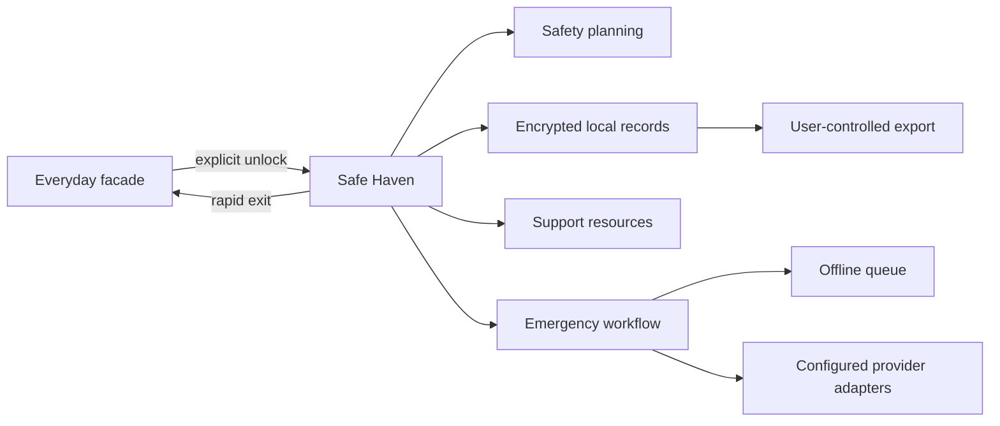

# Umkhuseli — The Protector

<div align="center">

**A discreet, low-data safety and evidence-support platform designed for South African conditions.**

[](https://github.com/Sankofa-Digital-Studio/Umk_Commercial/actions/workflows/ci.yml)
[](https://github.com/Sankofa-Digital-Studio/Umk_Commercial/releases/latest)
[](LICENSE)
[](https://github.com/orgs/Sankofa-Digital-Studio/projects/7)

[Live web preview](https://ishekomberera.vercel.app) ·
[Documentation](public/FINAL_MVP_DOCUMENTATION_INDEX.md) ·
[Releases](https://github.com/Sankofa-Digital-Studio/Umk_Commercial/releases) ·
[Roadmap](https://github.com/orgs/Sankofa-Digital-Studio/projects/7) ·
[Report a bug](https://github.com/Sankofa-Digital-Studio/Umk_Commercial/issues/new?template=bug_report.yml)

</div>

> [!CAUTION]
> **Umkhuseli is not a replacement for police, medical care, legal advice, or a guaranteed emergency-dispatch service.** In immediate danger in South Africa, call SAPS on **10111** or mobile emergency services on **112**. The national GBV Command Centre can be reached on **0800 428 428**. Availability and network delivery can vary; verify critical contacts independently.

## Why this project exists

Safety applications can create additional risk when a controlling person monitors a survivor's device. Umkhuseli explores a dual-persona approach: an everyday utility interface provides discreet access to safety planning, incident records, trusted-contact workflows, and nearby support information.

The project combines a React/TypeScript progressive web app with a native Android application. It prioritises low-connectivity operation, explicit consent, local data protection, and fast return to a neutral interface.

## Product status

Umkhuseli is an actively developed MVP and commercial pilot codebase. The repository contains working application code, automated tests, deployment configuration, research artifacts, and roadmap items. It does **not** claim that every integration is production-authorised or independently certified.

| Area | Current repository status |
|---|---|
| Web PWA | Deployable React/Vite application with automated tests and a public preview |
| Native Android | Kotlin/Jetpack Compose application source with JVM/Robolectric tests |
| Local evidence records | Encrypted-storage and integrity-support code with export tooling |
| Emergency workflows | Device intents, configurable server-side adapters, offline queues, and simulations; real delivery depends on configured providers, permissions, coverage, and operational validation |
| Court preparation | Structured incident-document export; generated files are preparation aids, not official court forms, legal advice, or proof of admissibility |
| Institutional integrations | Discovery and pilot work tracked on the [delivery roadmap](https://github.com/orgs/Sankofa-Digital-Studio/projects/7) |

## Core capabilities

| Capability | Purpose | Source |
|---|---|---|
| Dual-persona interfaces | Everyday calculator, music, devotional, and launcher facades provide discreet entry points | [`web/src/components`](web/src/components), [`app/src/main/java/com/example/ui`](app/src/main/java/com/example/ui) |
| Evidence-support vault | Protects locally stored incident records and supports integrity checks and PDF export | [`web/src/services/encryptedVaultDb.ts`](web/src/services/encryptedVaultDb.ts), [`app/src/main/java/com/example/service/VaultEncryptionHelper.kt`](app/src/main/java/com/example/service/VaultEncryptionHelper.kt) |
| Safety planning | Provides checklists, trusted-contact setup, and rapid-exit interactions | [`web/src/components/SafeHavenDashboard.tsx`](web/src/components/SafeHavenDashboard.tsx) |
| Support-centre discovery | Includes South African safety-resource and Thuthuzela Care Centre data | [`web/src/data/saSafetyData.ts`](web/src/data/saSafetyData.ts), [`app/src/main/java/com/example/data/repository/ThuthuzelaRepository.kt`](app/src/main/java/com/example/data/repository/ThuthuzelaRepository.kt) |
| Low-connectivity resilience | Uses local persistence and queued workflows when a network is unavailable | [`web/src/services/offlineOutbox.ts`](web/src/services/offlineOutbox.ts) |
| Quality controls | Runs web tests/builds and Android tests/builds in CI | [`.github/workflows/ci.yml`](.github/workflows/ci.yml) |

## Architecture



The web and Android clients share product goals but use platform-appropriate implementations. Cloud services are optional integration points rather than a substitute for local safety controls.

## Quick start

### Web PWA

Requirements: Node.js **22.19.0 or newer** and npm.

```bash
cd web
npm ci
npm test
npm run build
npm run dev
```

The development server prints its local URL, normally `http://localhost:5173`.

### Native Android

Requirements: JDK 21, Android Studio, and Android SDK 36.

```bash
# macOS/Linux
./gradlew testDebugUnitTest
./gradlew assembleDebug

# Windows
./gradlew.bat testDebugUnitTest
./gradlew.bat assembleDebug
```

Local service credentials belong in `.env`; start from [`.env.example`](.env.example) and never commit real keys.

## Repository map

```text
app/                 Native Android application
web/                 React/TypeScript progressive web app
supabase/            Database schema and optional Edge Functions
docs/                Product, architecture, compliance, and delivery documents
public/              Published documentation and presentation artifacts
.github/              CI, issue forms, ownership, and contribution automation
```

## Safety, privacy, and legal boundaries

- Do not use real survivor information in issues, screenshots, logs, demos, or test fixtures.
- Do not rely on camouflage as the only safety control. Device history, notifications, backups, accessibility services, and network records can still reveal activity.
- Emergency delivery is conditional on permissions, device state, provider configuration, network availability, and operational agreements.
- Cryptographic integrity can support an evidence trail; it does not by itself establish admissibility, authenticity, or legal sufficiency.
- South African forms and procedures change. Confirm the current process with the [Department of Justice and Constitutional Development](https://www.justice.gov.za/forms/form_dva.htm) or a qualified legal professional before filing.
- Support-centre details should be checked against the [National Prosecuting Authority's current TCC directory](https://www.npa.gov.za/thuthuzela-care-centres).

See [SECURITY.md](SECURITY.md) for private vulnerability reporting and [SUPPORT.md](SUPPORT.md) for product and crisis-support boundaries.

## Delivery and governance

- [Project board](https://github.com/orgs/Sankofa-Digital-Studio/projects/7) — authoritative delivery tracking
- [Issue #41](https://github.com/Sankofa-Digital-Studio/Umk_Commercial/issues/41) — workflow, milestone gates, and backlog index
- [CHANGELOG.md](CHANGELOG.md) — release-oriented change history
- [RELEASE_LOG.md](RELEASE_LOG.md) — detailed release evidence and historical context
- [Master documentation index](public/FINAL_MVP_DOCUMENTATION_INDEX.md) — architecture, requirements, governance, UAT, and presentation artifacts

## Contributing

Read [CONTRIBUTING.md](CONTRIBUTING.md) before opening a change. Safety-sensitive behavior requires a linked issue, threat-model notes, tests, and evidence that the neutral facade cannot expose protected state.

Security weaknesses must not be filed as public issues. Use [GitHub private vulnerability reporting](https://github.com/Sankofa-Digital-Studio/Umk_Commercial/security/advisories/new).

## License and trademarks

The source code is available under the [Apache License 2.0](LICENSE). The license governs use of the code in this repository. Product names, logos, and trademarks are not granted by the Apache License.

## Maintainer

Built and maintained by **Sankofa Digital Studio** in Johannesburg, South Africa. Commercial and partnership enquiries: `thosontula@gmail.com`.
